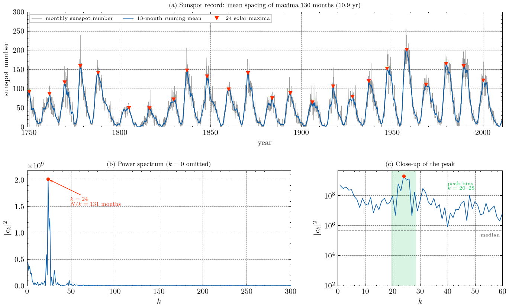
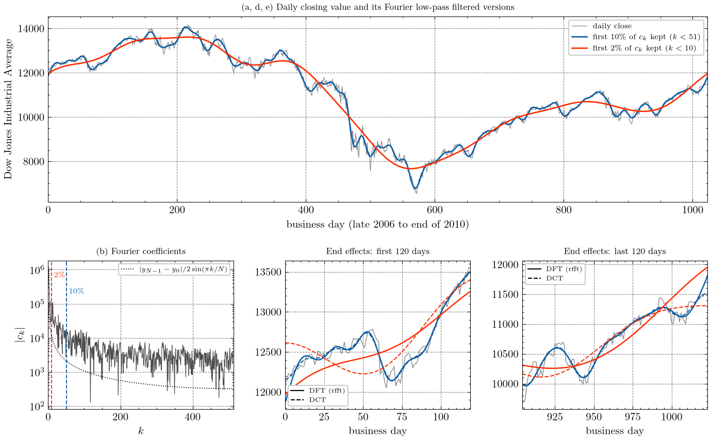
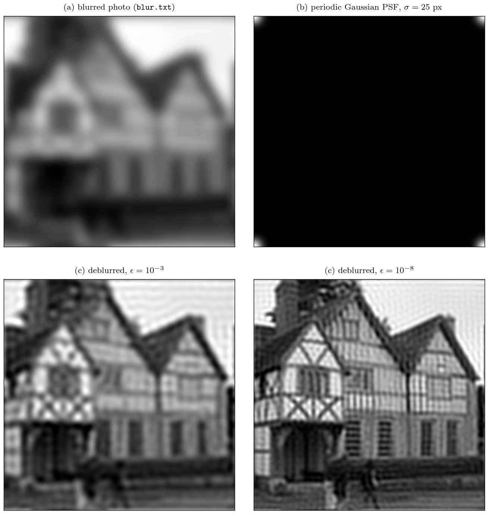
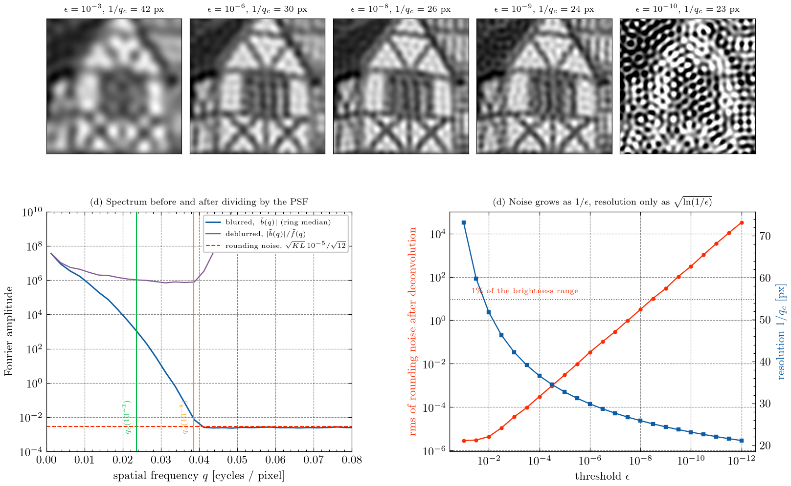

# Computational Physics — Homework 3

Fourier transforms: periodicity of the sunspot record (Newman 7.2), Fourier
low-pass filtering of the Dow Jones (Newman 7.4), and image deconvolution
(Newman 7.9).

## Running

The project uses [uv](https://docs.astral.sh/uv/). Figures use
[SciencePlots](https://github.com/garrettj403/SciencePlots) with LaTeX text, and
`plotstyle.py` falls back to matplotlib mathtext if no LaTeX toolchain is found
(on Arch: `paru -S texlive-bin texlive-latexextra texlive-mathscience`).

```
uv sync
uv run python problem1.py
uv run python problem2.py
uv run python problem3.py
```

Figures are written to `figs/` and printed output is saved in `results/`. The
homework writeup (Summary / Methods / Results / Code) is
[`writeup/hw3_writeup.pdf`](writeup/hw3_writeup.pdf), built from
`writeup/hw3_writeup.tex` with `latexmk -pdf`.

| file | contents |
| --- | --- |
| `plotstyle.py` | shared SciencePlots configuration |
| `problem1.py` | sunspot cycle from the smoothed series and from the power spectrum |
| `problem2.py` | rfft low-pass filter of the Dow Jones (10% and 2%), DCT comparison |
| `problem3.py` | periodic Gaussian PSF, deconvolution with threshold ε, noise/resolution analysis |
| `data/` | `sunspots.txt`, `dow.txt`, `blur.txt` from the book's online resources |

---

## Problem 1 — detecting periodicity (Newman 7.2)

**(a)** The 13-month running mean has 24 maxima from 1750.2 to 2000.2, so 23
cycles: mean cycle length **130.4 months = 10.9 yr** (individual cycles 88–204
months, scatter 24 months).

**(b, c)** The power spectrum |c_k|² (k = 0 left out) has its peak at
**k = 24**, period N/k = 3143/24 = **131.0 months = 10.9 yr**, agreeing with (a)
to 0.5 months. The peak spans k = 20–28 (periods 112–157 months) because the
cycle length varies; the bin spacing near the peak is ΔT ≈ T²/N ≈ 5 months.



---

## Problem 2 — Fourier filtering and smoothing (Newman 7.4)

N = 1024 days → 513 rfft coefficients.

| kept | k | shortest period kept | rms residual |
| --- | --- | --- | --- |
| 10% | 0–50 | 20.5 business days (~1 month) | 143 |
| 2% | 0–9 | 114 business days (~5 months) | 346 |

Zeroing the high-k coefficients is a low-pass filter: the fast day-to-day
fluctuations disappear and the trend (2007 peak, 2008 crash, March 2009 low at
6547, recovery) remains; with 2% only the broad trend survives. Both filtered
curves are pulled towards the midpoint 11800 at the two ends, with Gibbs
ringing, because the DFT treats the series as periodic and sees a −644 jump from
the last day back to the first. A DCT (mirrored series, no jump) with the same
fraction of coefficients ends at 12156 / 11519, close to the data 12122 / 11478.



---

## Problem 3 — image deconvolution (Newman 7.9)

The PSF is a periodic Gaussian (σ = 25) normalised to unit sum, so f̃(0) = 1 and
ε is a relative attenuation threshold; f̃(q) = exp(−2π²σ²q²) to machine
precision. Modes with |f̃| > ε are divided, the rest left alone.



| ε | resolution 1/q_c [px] | noise rms after deconvolution | reblur residual |
| --- | --- | --- | --- |
| 1e-3 (book) | 42 | 4e-5 | 0.075 |
| 1e-6 | 30 | 0.034 | 6e-5 |
| 1e-8 | 26 | 3.2 | 6e-6 |
| 1e-9 | 24 | 29 | 6e-6 |
| 1e-10 | 23 | 306 | 6e-6 |

The only noise in `blur.txt` is rounding to 5 decimals (rms 2.9e-6), so ε can be
pushed to ~1e-8 (noise 0.4% of the brightness range) for a noticeably sharper
picture; at 1e-10 the noise buries it. Reblurring the result reproduces the data
to the rounding level, confirming an exact periodic Gaussian blur.

**(d)** The spectrum of the blurred photo meets a flat noise floor at
q ≈ 0.04 cycles/px (level 0.83 × the predicted rms √(KL)·1e-5/√12, as expected
for complex Gaussian noise). Above it the photo holds no information about the
original, and dividing by f̃ only amplifies noise. Output noise grows as
≈ 0.011 σ_in/ε, but for a Gaussian blur the resolution grows only as
√ln(1/ε): ε = 1e-3 → 1e-8 costs 1e5 in noise for a factor 1.63 in resolution.
For an 8-bit photo the same 1%-noise rule gives ε ≈ 1.2e-3, the book's value.
Perfect deblurring is impossible because fine detail is suppressed below the
noise and is lost for good.


